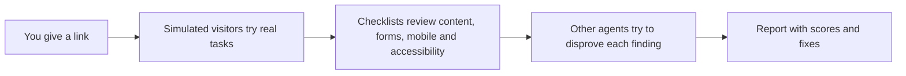

# Blindspot

**See your website the way a first-time visitor sees it.**

You built your site, so you know what every button does. Your visitors don't. That gap is your blind spot.

Blindspot is a skill for Claude. It sends simulated visitors who know nothing about your site through it, watches where they get lost, and gives you a report with ratings, problems and fixes.

## What you get

- A **score from 0 to 10** for clarity, navigation, trust, content, design, forms, mobile and accessibility.
- A list of **problems with evidence**, a suggested fix and how hard it is to fix. The quick wins come first.
- What **works well**, so you don't break it.
- Pros and cons in plain words.

## Install

**Claude Code**

```bash
git clone https://github.com/dimazbtw/blindspot-skill ~/.claude/skills/blindspot
```

**Claude.ai** (needs a plan that offers Skills, with code execution and file creation turned on)

```bash
git clone https://github.com/dimazbtw/blindspot-skill blindspot
zip -r blindspot.zip blindspot -x "blindspot/.git/*"
```

Then go to **Settings → Capabilities → Skills → Upload skill** and pick `blindspot.zip`.
Or just go to releases in this repo and double click on .skill file and open with Claude or ChatGPT
Don't use GitHub's "Download ZIP": the folder name must be `blindspot`.

## Use it

In Claude Code:

```text
/blindspot https://your-site.com
```

Or just ask, in any language:

- *Test https://your-site.com like a first-time customer and give me a report.*
- *Quick first-impression check of this landing page.*
- *Test only my checkout. Most customers use phones.*
- *I changed the pricing page. Retest and tell me if it improved.*

Optional extras that make the test better: who your customers are, what the site is meant to do, and anything that worries you.

## How it works



The testers never see your brief or the code, so they react like real strangers.

## Example result

From the bundled example, a fictional bakery site:

| Category | Score |
|---|---|
| Clarity | 6.5 |
| Navigation | 6.5 |
| Trust | 8.0 |
| Content | 6.5 |
| Forms and flows | 6.5 |
| Accessibility | 7.5 |
| Design, Mobile | not assessed (text-only evidence) |
| **Overall** | **6.9, fair** |

Top finding: *the home page never says what the bakery sells.* Fix: put one plain sentence in the first heading.

## Good to know

- **Read-only.** It never submits forms, buys anything or creates accounts.
- **No browser?** It reads pages as text. Design and mobile are then marked "not assessed" instead of guessed.
- **Simulations, not customers.** Confirm the big problems with 3 to 5 real people.
- **Five modes:** `full`, `quick`, `focus`, `retest` and `deepen`. It picks one from your request.
- Reports come in the language you write in.

## Learn more

Start with [`SKILL.md`](SKILL.md). Then [`SCORING.md`](SCORING.md) for how scores work, [`PERSONAS.md`](PERSONAS.md) for the visitors, [`RETEST.md`](RETEST.md) for measuring progress, and [`examples/bakery/`](examples/bakery/) for a full sample run.

To run the checks on the tooling: `python3 -m unittest discover -s scripts/tests`

Early version, tested on a fictional example. Feedback from real sites is welcome.

## License

MIT, see [`LICENSE`](LICENSE).
